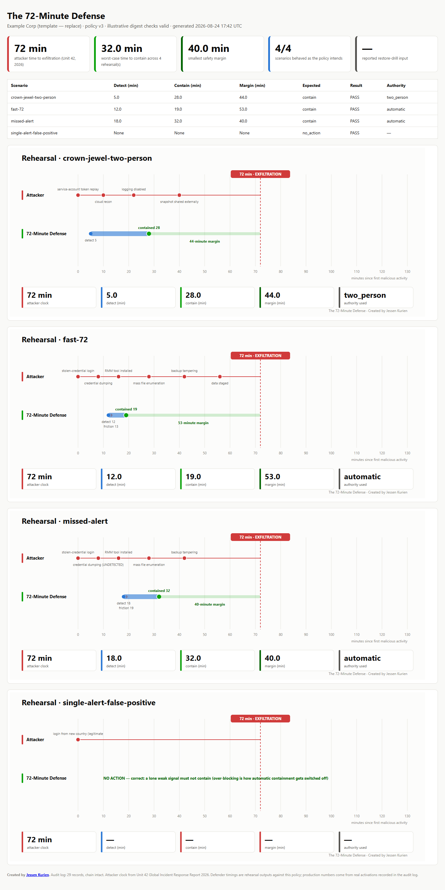

# The 72-Minute Defense

**Open-source incident-response governance for pre-authorized ransomware containment.** It gives CISOs, SOC leaders, incident commanders, GRC teams, and platform owners a transparent way to decide containment authority before an incident and rehearse whether that authority is fast enough.

Created and maintained by [Jessen Kurien](https://github.com/jessenkurien).

> [!IMPORTANT]
> **Reference implementation:** This project is intended for research, evaluation, and
> organizational adaptation. It is dry-run by default. It is not a substitute for
> organization-specific legal, regulatory, privacy, or production-security review, and it
> does not establish compliance or operating effectiveness.

[](https://github.com/jessenkurien/72-minute-defense/actions/workflows/ci.yml)




Unit 42's 2026 report uses 72 minutes as the quickest-quartile time from compromise to data exfiltration. This project turns that external benchmark into a management question: **has the organization pre-authorized enough safe action to contain an attacker before that clock expires?**

## Current synthetic rehearsal

| Scenario | Decision being tested | Result |
|---|---|---:|
| Fast precursor chain | Automatic containment | Minute 19; 53-minute margin |
| Crown-jewel host | Two-person approval at 8 and 14 minutes | Minute 28; 44-minute margin |
| Missed credential alert | Tolerance of a detection gap | Minute 32; 40-minute margin |
| Lone CEO login anomaly | False-positive restraint | No containment action, as expected |

These are deterministic outputs from synthetic scenarios in this repository. They are **not production performance measurements, a product certification, or evidence that a particular organization can contain in these times**.

## The need

Most security platforms already expose APIs to revoke sessions, disable identities, isolate endpoints, quarantine cloud accounts, and protect backups. The harder problem is organizational: at 2 a.m., who has authority to use which action, against which systems, at what blast radius, and with what review?

The project makes that decision explicit and testable. It is not a SOAR, SIEM, EDR, or incident-management replacement. It is a reference pattern for the governance and decision layer around those systems.

## How it works

1. **Digest-attested policy as code.** [`policy/containment-authority.yaml`](policy/containment-authority.yaml) defines four tiers, thresholds, actions, approvers, ceilings, protected entities, accepted impacts, and review deadlines. Any body edit invalidates the embedded digest attestations. The names in the public template are illustrative. Attestations detect changes; signer identity must be authenticated by protected review, signed commits, or an external approval system.

2. **Precursor-chain scoring.** [`seventytwo/scoring/engine.py`](seventytwo/scoring/engine.py) maps normalized signals to an ATT&CK-aligned chain, applies confidence and decay, clusters users with related hosts, deduplicates delivery retries, and uses the strongest occurrence of each distinct signal. High-confidence critical signals can set a containment-tier floor.

3. **Decisioning that never invents authority.** [`seventytwo/engine/decide.py`](seventytwo/engine/decide.py) combines score, policy, and business context. Protected, crown-jewel, over-ceiling, and unknown assets escalate. Its central rule is: **do what is pre-authorized now; escalate the rest.**

4. **Vendor adapters.** Dry-run adapters build request previews for Microsoft Entra ID, Defender for Endpoint, Okta, CrowdStrike Falcon, and AWS IAM/Organizations/Backup. All are mock or stub tested. None has been validated here against a live vendor tenant, and previewed requests may differ from final live calls when an API requires discovery or enumeration.

5. **Hash-chained audit records.** [`seventytwo/engine/audit.py`](seventytwo/engine/audit.py) records the decision, action attempt, and result. The chain detects interior edits, reordering, and deletion. It cannot prove that an intact tail was not truncated or that the whole file was not replaced; production use requires immutable external anchoring or export.

6. **Rehearsal and policy gate.** Four synthetic scenarios traverse the real scoring, decision, and execution paths using the mock adapter. CI fails when attestations go stale, code tests fail, or a scenario loses its expected outcome.

## Safety posture

- Dry-run is the default.
- The included `Example Corp` policy has `template: true` and **cannot be armed**.
- An operational policy must be effective, unexpired, fully attested, and match an out-of-band `SEVENTYTWO_POLICY_DIGEST` pin.
- CLI `--approve` values are rehearsal/simulation inputs only. Live approver-tier execution requires verified approvals from a trusted integration.
- Unknown assets fail safe to two-person escalation.
- The AWS backup action uses removable governance mode; it deliberately does not create an irreversible compliance-mode vault lock.
- `mandatory_review_minutes` creates a review deadline. The project does not automatically re-enable a user or reconnect a host, because blind automatic restoration can reintroduce an attacker.

Read [`THREAT_MODEL.md`](THREAT_MODEL.md) before experimenting with live execution.

## Try it locally

```bash
python -m venv .venv
# Windows: .venv\Scripts\activate
# macOS/Linux: source .venv/bin/activate
pip install -e ".[dev]"

72md policy verify
72md rehearse --out out --audit out/audit.jsonl --fail-if-late
72md audit verify --audit out/audit.jsonl
72md act --events examples/sentinel-backup-tamper.json --format sentinel --adapters entra,defender
```

The last command is a dry run. It prints request previews and does not contact a tenant.

## Evidence and leadership artifacts

- [`docs/executive-brief.md`](docs/executive-brief.md) — one-page discussion brief
- [`docs/grc/control-mapping.md`](docs/grc/control-mapping.md) — framework and evidence mapping
- [`docs/grc/raci-and-risk-register.md`](docs/grc/raci-and-risk-register.md) — RACI and fill-in risk entry
- [`docs/grc/gdpr.md`](docs/grc/gdpr.md) — GDPR/DPIA discussion template, not legal advice
- [`docs/tabletop.md`](docs/tabletop.md) — 90-minute tabletop exercise
- [`docs/delivery/plan.md`](docs/delivery/plan.md) — staged 90-day implementation template
- [`docs/architecture.md`](docs/architecture.md) and [`docs/adapters.md`](docs/adapters.md) — design and integration boundaries

The control mapping says “supports” and “produces evidence for,” not “compliant” or “certified.” An organization's control owners and assessors must determine whether the implementation is designed and operating effectively in their environment.

## Verified project status

```text
57 tests passed
86% statement coverage
Ruff lint and format checks passed
4/4 synthetic scenarios passed
Illustrative policy digest checks valid; public template blocked from live execution
```

## Honest limitations

- Adapter coverage is mock/stub validation, not tenant certification.
- Scoring weights are a transparent starting hypothesis, not a trained model or detection guarantee.
- Rehearsal latency comes from scenario files; replace it with measured SIEM, analyst, approval, and platform latency before making an operational claim.
- The embedded digest proves file consistency, not the identities or authority of the named approvers.
- The JSONL audit chain needs external anchoring for strong completeness claims.
- Regulatory mappings are implementation aids, not legal advice or an attestation of compliance.

## International use

The governance problem is global, but authority, employment law, privacy obligations, sector rules, terminology, and response procedures are local. Treat the 72-minute benchmark as an external stress-test target—not a prediction, service-level agreement, or universal threshold. Adapt the policy with local incident-response leadership, legal counsel, privacy/DPO teams, works councils or employee representatives where applicable, asset owners, and relevant regulators. Framework and regulatory mappings are navigation aids; they do not establish compliance in any jurisdiction.

## Incident leadership series

This project is part of an open-source cyber leadership portfolio:

- **[Cyber Incident Commander Toolkit](https://github.com/jessenkurien/cyber-incident-commander-toolkit)** — coordinates people, objectives, evidence, decisions, and executive communication during a cyber incident.
- **[The 72-Minute Defense](https://github.com/jessenkurien/72-minute-defense)** — defines which containment actions can be pre-authorized and rehearses whether the organization can act before the attacker's clock expires.

Together, they connect incident command with governed, measurable containment.

## Community and commercial use

### Community/reference implementation

This public repository is an open-source reference implementation for learning, evaluation,
rehearsal, and organization-specific adaptation. The MIT-licensed project is provided without
a deployment commitment, support service, warranty, or assurance that its illustrative policy
is appropriate for a particular environment. Use the safety posture, threat model, and staged
validation guidance before considering any live integration.

### Commercial implementation, integration, and advisory services

Production implementation, organization-specific policy design, vendor and workflow
integration, incident-command assessments, tabletop exercises, and advisory services are
separate from the community reference implementation. Organizations interested in
authority-model design, incident-command assessments, tabletop exercises, or implementation
pilots may contact the project author through [Jessen Kurien's GitHub profile](https://github.com/jessenkurien).

## References and attribution

- Palo Alto Networks Unit 42, [Global Incident Response Report 2026](https://www2.paloaltonetworks.com/resources/research/unit-42-incident-response-report): quickest-quartile time to exfiltration of 72 minutes and identity weaknesses in 89% of investigations.
- NIST [Cybersecurity Framework 2.0](https://www.nist.gov/cyberframework) and [SP 800-61 Rev. 3](https://csrc.nist.gov/pubs/sp/800/61/r3/final).
- ATT&CK® content © The MITRE Corporation. See [`NOTICE`](NOTICE).
- Not affiliated with or endorsed by Microsoft, Okta, CrowdStrike, Amazon Web Services, Palo Alto Networks, NIST, or MITRE.

## Attribution and citation

If this project informs your policy, research, training, presentation, or derivative work, please credit **“The 72-Minute Defense by Jessen Kurien”** and link to this repository. GitHub's **Cite this repository** control can generate a formal citation from [`CITATION.cff`](CITATION.cff).

The MIT License permits reuse, modification, and redistribution subject to retaining its copyright and permission notice. The credit request above helps people find the original work; it does not add a restriction beyond the license.

## License

Copyright © 2026 Jessen Kurien. Licensed under the MIT License; see [`LICENSE`](LICENSE) and
[`NOTICE`](NOTICE). Built by [Jessen Kurien](https://github.com/jessenkurien) — CISM, CISA,
cybersecurity and incident-response leadership. Contributions are welcome under the DCO; see
[`CONTRIBUTING.md`](CONTRIBUTING.md).
